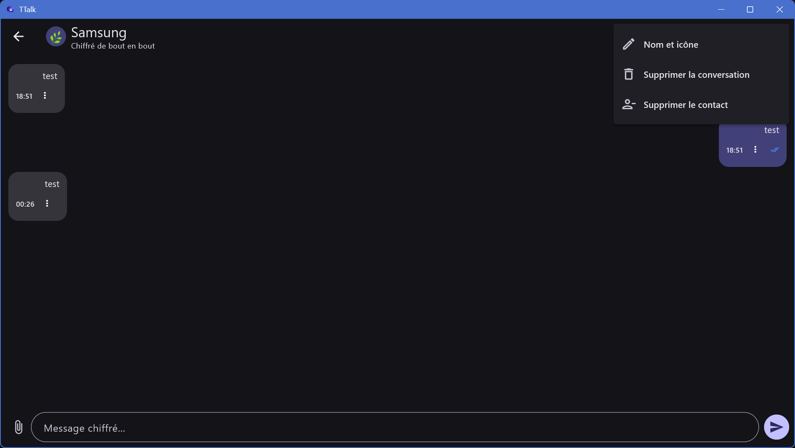
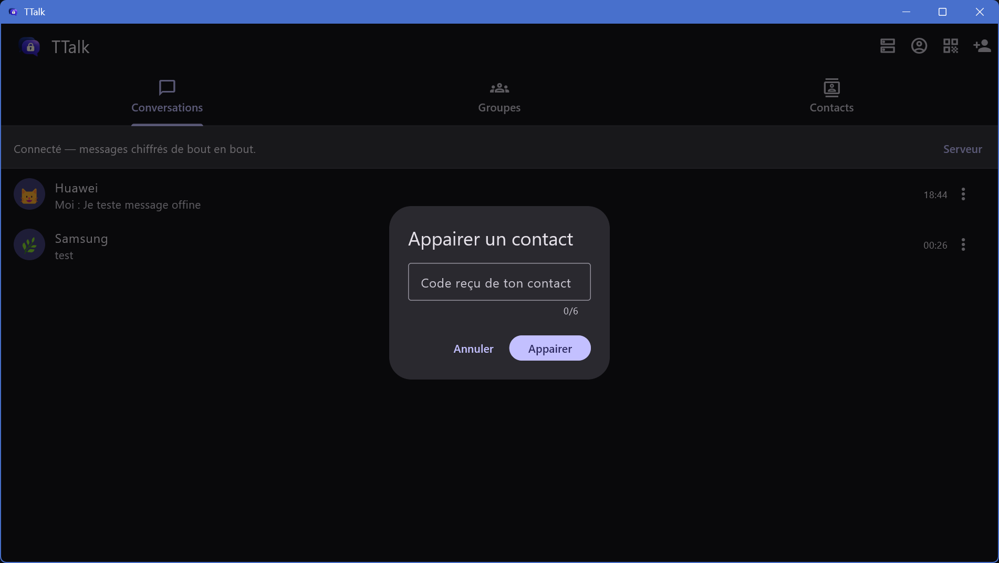
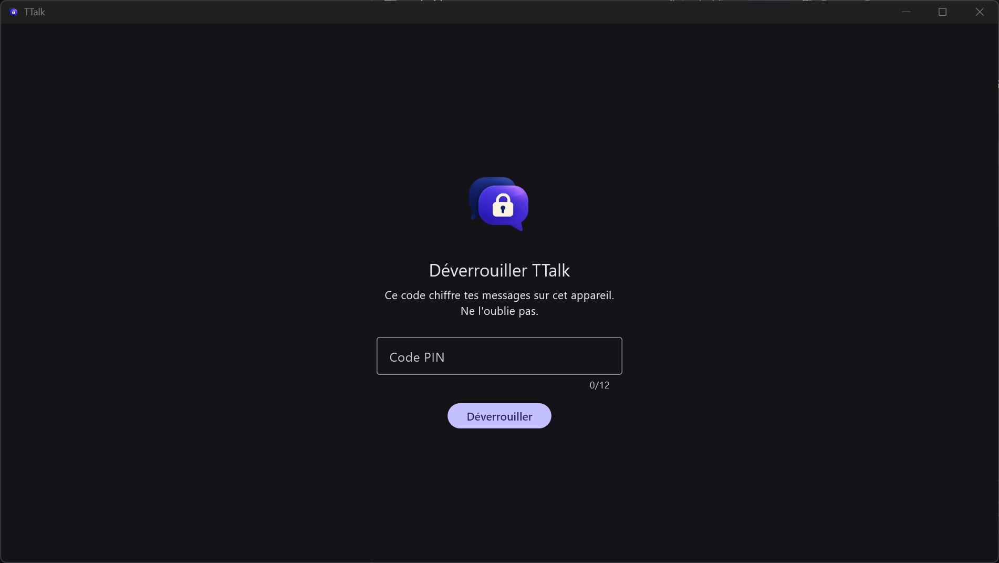
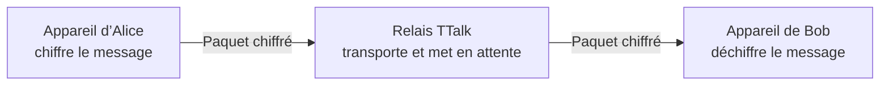

  

# TTalk

### Messagerie privée. Chiffrement de bout en bout. Relais à votre choix.

**TTalk** permet d’échanger des messages, des fichiers et des conversations de
groupe. Le contenu est chiffré sur l’appareil de départ et déchiffré sur celui
du destinataire. Vous choisissez le relais qui transporte les messages.

  
  
  
  
  
  

**[Télécharger](#téléchargement)** · **[Démarrer](docs/GETTING_STARTED.md)** ·
**[Sécurité](docs/SECURITY.md)** · **[Releases](https://github.com/btalal/TTalk/releases)**

## Aperçu de TTalk sur Windows

**Conversation chiffrée** — échanges directs et accusés de lecture.

**Appairage** — saisir le code transmis par un contact, puis comparer les
numéros de sécurité par un autre canal.

**Coffre local** — le PIN déverrouille les messages enregistrés sur cet appareil.

## Fonctionnalités

| | TTalk 0.5.1 |
|---|---|
| 💬 Conversations | Messages directs et accusés de réception et de lecture |
| 📎 Fichiers | Pièces jointes chiffrées pendant le transfert, jusqu’à 5 Mo |
| 👥 Groupes | Invitations, gestion des membres et transfert de propriété |
| 🔒 Contacts | Appairage par code et vérification des numéros de sécurité |
| 🌍 Hébergement | Relais HTTPS au choix, y compris auto-hébergé |

Les échanges Windows et Android ont été essayés sur deux PC et un téléphone.
**iPhone et macOS restent des préversions à tester sur appareil réel.**

### Différences de conception

| | TTalk | WhatsApp | Telegram |
|---|---|---|---|
| Relais des conversations | Adresse choisie par les utilisateurs | Service WhatsApp | Cloud Telegram |
| Chiffrement de bout en bout des discussions personnelles | Oui | Oui | « Secret Chats » uniquement ; les discussions Cloud suivent un autre modèle |

Ce tableau décrit le **choix du relais et le mode de chiffrement**, pas la
qualité globale de sécurité. TTalk est plus jeune et n’a pas été audité
indépendamment. Sources : [confidentialité WhatsApp](https://www.whatsapp.com/privacyquestions)
et [FAQ Telegram](https://telegram.org/faq).

## Téléchargement

| Plateforme | État | Où commencer |
|---|---|---|
| Windows 10/11 x64 | Version 0.5.1 | [ZIP Windows](https://github.com/btalal/TTalk/releases/tag/v0.5.1-windows) : extraire toute l’archive et lancer `TTalk.exe`. |
| Android 7.0+ | Version 0.5.1 | [APK signé](https://github.com/btalal/TTalk/releases/tag/android-v0.5.1) : télécharger `ttalk-android.apk`. |
| iPhone (iOS 15+) | Préversion | [IPA non signé](https://github.com/btalal/TTalk/releases/tag/v0.5.1-iphone-mac-preview.1) : signature personnelle nécessaire avant installation. |
| macOS | Préversion | [Archive de test](https://github.com/btalal/TTalk/releases/tag/v0.5.1-iphone-mac-preview.1) non signée et non notarisée ; voir le guide de la release. |

Un **relais HTTPS** est nécessaire pour communiquer entre appareils. Son adresse
se saisit dans **Configurer le serveur** ; elle n’est pas imposée par TTalk.
[Démarrage rapide](docs/GETTING_STARTED.md) · [Guide mobile](docs/MOBILE_INSTALL.md) ·
[Guide du relais](server/README.md)

## Sécurité en bref

- **X25519** et **HKDF-SHA256** établissent les clés des conversations directes.
- **AES-256-GCM** chiffre les messages et les fichiers avant leur envoi.
- Le coffre local utilise **PBKDF2-HMAC-SHA256** pour dériver une clé depuis le PIN.
- Les **numéros de sécurité** permettent de vérifier les clés des contacts par
  un autre canal ; le code d’appairage seul ne suffit pas.
- Le relais ne reçoit pas le contenu en clair. Il voit toutefois des
  **métadonnées de routage** et peut retarder ou bloquer la livraison.

TTalk **n’a pas fait l’objet d’un audit cryptographique indépendant**. Les
conversations directes ne renouvellent pas les clés à chaque message ; les
groupes ont aussi des limites. Lire le [modèle de sécurité](docs/SECURITY.md)
avant un usage sensible.

## FAQ

**Le relais peut-il lire les messages ?** En fonctionnement normal, non : leur
contenu est chiffré avant l’envoi. Le relais voit les métadonnées nécessaires
au transport.

**Puis-je héberger mon propre relais ?** Oui. TTalk accepte l’adresse HTTPS du
relais de votre choix. [Guide de déploiement](server/README.md).

**Les notifications mobiles fonctionnent-elles ?** Pas encore. Les messages
en attente sont récupérés à la réouverture de l’application.

**L’iPhone et le Mac sont-ils prêts pour tous ?** Non. L’IPA iPhone doit être
signé et l’archive macOS n’est ni signée ni notarisée.

## Documentation

- [Démarrage et appairage](docs/GETTING_STARTED.md)
- [Sécurité et limites](docs/SECURITY.md)
- [Installation mobile](docs/MOBILE_INSTALL.md)
- [Gestion des conversations et groupes](docs/CHAT_MANAGEMENT.md)
- [Développement et migration](docs/DEVELOPMENT.md)
- [Déploiement du relais](server/README.md)
- [Feuille de route](docs/ROADMAP.md)
- [Historique des versions](CHANGELOG.md)

TTalk est distribué sous [licence Apache-2.0](LICENSE).
