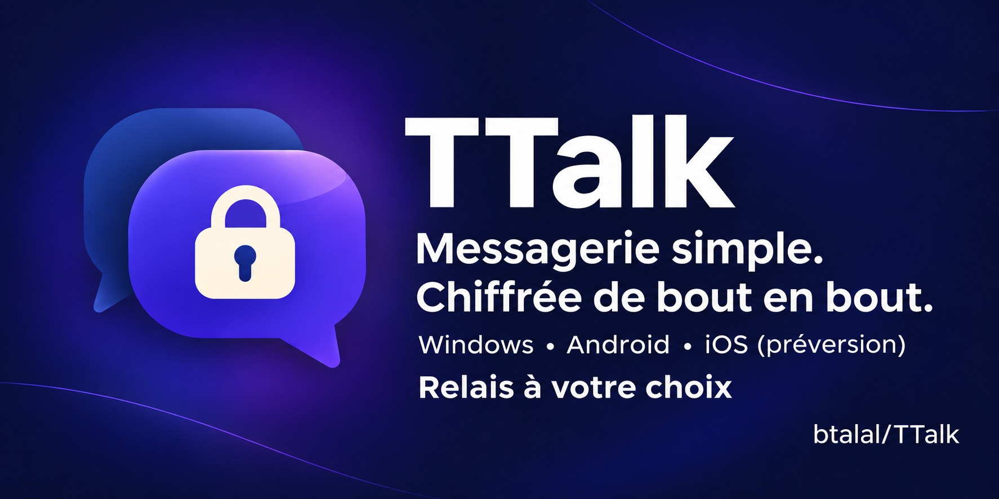
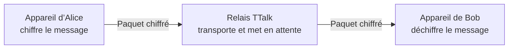

<p align="center">
  
</p>

# TTalk

> **Développement 0.6** : [fonctions et validation en cours](docs/NEXT_VERSION.md).
> Les nouvelles fonctions de cette branche ne sont pas encore une version finale.

### Messagerie privée. Chiffrement de bout en bout. Relais à votre choix.

**TTalk** est une messagerie chiffrée et open source pour Windows, Android, iPhone et macOS. Échangez des messages, des fichiers
et des conversations de groupe sur un relais que vous choisissez.

🔒 Chiffrement de bout en bout · 🌍 Relais auto-hébergeable ·
👥 Groupes chiffrés · 📂 Fichiers chiffrés pendant le transfert

<p>
  <a href="https://github.com/btalal/TTalk/releases/tag/v0.5.1-windows"></a>
  <a href="https://github.com/btalal/TTalk/releases/tag/android-v0.5.1"></a>
  <a href="https://github.com/btalal/TTalk/releases/tag/v0.5.1-apple"></a>
  
  <a href="docs/SECURITY.md"></a>
  <a href="LICENSE"></a>
</p>

**[Télécharger](#téléchargement)** · **[Démarrer](docs/GETTING_STARTED.md)** ·
**[Sécurité](docs/SECURITY.md)** · **[Releases](https://github.com/btalal/TTalk/releases)**

## Pourquoi TTalk ?

TTalk s’adresse aux personnes qui veulent choisir l’infrastructure qui
transporte leurs conversations. Les messages et fichiers sont chiffrés sur
l’appareil avant l’envoi ; en fonctionnement normal, le relais ne reçoit pas
leur contenu en clair. Il peut toutefois voir des métadonnées de routage et
conserver temporairement des paquets chiffrés pour les appareils absents.

Chaque appareil possède ses propres clés. Vous pouvez vérifier celles d’un
contact en comparant vos numéros de sécurité par un autre canal.

## Fonctionnalités principales

| | TTalk 0.5.1 |
|---|---|
| 💬 Conversations | Messages directs et accusés de réception et de lecture |
| 🔒 Chiffrement | X25519 + HKDF-SHA256 pour les clés ; AES-256-GCM pour les messages |
| 🛡 Coffre local | PIN et stockage sécurisé propre à chaque système |
| 📎 Fichiers | Pièces jointes chiffrées pendant le transfert, jusqu’à 5 Mo |
| 👥 Groupes | Invitations, gestion des membres et transfert de propriété |
| 🔑 Contacts | Appairage par code et vérification des numéros de sécurité |
| 🌍 Hébergement | Relais HTTPS au choix, y compris auto-hébergé |

Les échanges Windows et Android ont été essayés sur deux PC et un téléphone.
**Les versions finales iPhone et Mac ont été validées le 6 novembre 2026**
sur iPhone 17 Pro sous iOS 27.2 et Mac mini M4 : serveur, contacts et
messages envoyés/reçus. Le lancement autonome fonctionne sur les deux ;
la conservation des messages après fermeture et réouverture a aussi été
vérifiée sur Mac. Installation Apple avec signature personnelle dans Xcode.
[Détail des essais et limites](docs/APPLE_VALIDATION.md).

## Aperçu

### Bureau (Windows)

**Conversation chiffrée** — échanges directs et accusés de lecture.


**Appairage** — saisir le code transmis par un contact, puis comparer les
numéros de sécurité par un autre canal.


**Coffre local** — le PIN déverrouille les messages enregistrés sur cet appareil.


Les vues Android et de groupes seront ajoutées dès que des captures réelles
et anonymisées seront disponibles.

## Comparaison

| Fonction | TTalk | WhatsApp | Telegram |
|---|:---:|:---:|:---:|
| Application et relais open source | ✅ | ❌ | Partiel : applications clientes |
| Relais personnel | ✅ | ❌ | ❌ |
| Chiffrement de bout en bout des discussions | ✅ | ✅ pour les discussions personnelles | Partiel : conversations secrètes |
| Contrôle de l’hébergement des messages en attente | ✅ | ❌ | ❌ |
| Auto-hébergement du relais | ✅ | ❌ | ❌ |
| Vérification des clés avec un contact | ✅ | ✅ | Partiel : conversations secrètes |

La comparaison porte sur les **fonctions indiquées**, pas sur le niveau global
de sécurité. « Contrôle de l’hébergement » signifie que vous choisissez où
fonctionne le relais TTalk ; les copies chez les destinataires et les
métadonnées restent soumises aux [limites du modèle de sécurité](docs/SECURITY.md).
TTalk n’a pas été audité indépendamment. Telegram permet bien de comparer les
clés dans ses conversations secrètes, contrairement à ce que suggère une simple
croix dans cette case. Sources : [licence TTalk](LICENSE),
[confidentialité WhatsApp](https://www.whatsapp.com/privacyquestions),
[codes de sécurité WhatsApp](https://faq.whatsapp.com/1524220618005378) et
[FAQ Telegram](https://telegram.org/faq).

## Téléchargement

| Plateforme | État | Où commencer |
|---|---|---|
| Windows 10/11 x64 | Version 0.5.1 | [ZIP Windows](https://github.com/btalal/TTalk/releases/tag/v0.5.1-windows) : extraire toute l’archive et lancer `TTalk.exe`. |
| Android 7.0+ | Version 0.5.1 | [APK signé](https://github.com/btalal/TTalk/releases/tag/android-v0.5.1) : télécharger `ttalk-android.apk`. |
| iPhone (iOS 15+) | Version finale 0.5.1 | [Release Apple](https://github.com/btalal/TTalk/releases/tag/v0.5.1-apple) ; [installation en Release via Xcode](docs/MOBILE_INSTALL.md), signature personnelle requise. |
| macOS 12+ | Version finale 0.5.1, validée sur M4 | [Release Apple](https://github.com/btalal/TTalk/releases/tag/v0.5.1-apple) ; [compilation et signature Xcode](docs/MACOS_INSTALL.md). Archive CI non signée, sans notarisation. |

### Installer sur Windows

1. Télécharger `ttalk-windows-x64.zip` depuis la release Windows.
2. Extraire **toute** l’archive.
3. Lancer `TTalk.exe` ; conserver le dossier `app/` à côté du lanceur.

```text
TTalk.exe
LIRE-MOI.txt
app/
```

Sur Android, installer l’APK **signé** `ttalk-android.apk` sans désinstaller
une version précédente si vous souhaitez conserver les données locales.
Sur iPhone et Mac, utiliser Xcode avec votre compte Apple et la configuration
**Release**. Les archives CI ne sont pas des installateurs Apple signés. Voir le
[guide mobile](docs/MOBILE_INSTALL.md) et le [guide Mac](docs/MACOS_INSTALL.md).

Un **relais HTTPS** est nécessaire pour communiquer entre appareils. Son adresse
se saisit dans **Configurer le serveur** ; elle n’est pas imposée par TTalk.
[Démarrage rapide](docs/GETTING_STARTED.md) · [Guide mobile](docs/MOBILE_INSTALL.md) ·
[Guide du relais](server/README.md)

## Sécurité

| Protection | Technologie | Ce qu’elle fait |
|---|---|---|
| Échange de clés | X25519 | Établit un secret partagé entre contacts appairés. |
| Dérivation des clés de session | HKDF-SHA256 | Dérive les clés des conversations directes. |
| Messages et fichiers en transit | AES-256-GCM | Chiffre le contenu avant son envoi au relais. |
| Coffre local | PBKDF2-HMAC-SHA256 et AES-256-GCM | Dérive une clé depuis le PIN et chiffre les données locales. |
| Vérification d’identité | Empreinte SHA-256 des clés publiques | Fournit un numéro de sécurité à comparer par un autre canal. |
| Relais | Paquets chiffrés | Transporte le contenu sans recevoir les clés privées ni le texte en clair. |

### Vérifier l’identité d’un contact

Chaque contact appairé possède un **numéro de sécurité** calculé à partir des
clés publiques des deux appareils. Comparez ce numéro par un canal fiable,
par exemple lors d’une rencontre ou d’un appel dont vous reconnaissez la voix.
Le code d’appairage seul ne suffit pas à écarter une substitution de clé.

### Comment ça fonctionne ?



Le relais peut voir les identifiants de routage, les horaires, les tailles des
paquets et certaines clés publiques. Il peut aussi retarder ou bloquer les
échanges : le chiffrement de bout en bout ne garantit pas l’anonymat ni la
disponibilité du service.

TTalk **n’a pas fait l’objet d’un audit cryptographique indépendant**. Les
conversations directes ne renouvellent pas les clés à chaque message ; les
groupes ont aussi des limites. Lire le [modèle de sécurité](docs/SECURITY.md)
avant un usage sensible.

## Fonctionnalités avancées

### Accusés de réception et de lecture

| Indicateur | État dans TTalk |
|---|---|
| Horloge | Envoi en attente d’acceptation par le relais |
| ✓ | Paquet accepté par le relais |
| ✓✓ gris | Paquet reçu par l’application destinataire |
| ✓✓ bleu | Conversation ouverte par l’application destinataire |

Ces indicateurs décrivent l’état des applications ; ils ne prouvent pas qu’une
personne a effectivement lu le message.

### Pièces jointes

Chaque fichier est chiffré localement avec une clé AES-256-GCM propre avant
son envoi. La limite est de **5 Mo**. Après réception, le fichier est
déchiffré et enregistré sur l’appareil destinataire ; sa copie enregistrée
**n’est plus protégée par le chiffrement du transfert**.

### Groupes

Les groupes permettent de gérer les membres, de réinviter un contact et de
transférer la propriété. Le retrait d’un membre entraîne une nouvelle clé
pour les messages suivants. Cette protection dépend encore de l’exclusion
du membre par le relais : voir les [limites de sécurité](docs/SECURITY.md).
Les menus de suppression retirent les copies **locales**, sans effacer celles
des autres participants. [Guide des groupes et conversations](docs/CHAT_MANAGEMENT.md).

## Auto-hébergement du relais

Le [serveur TTalk](server/README.md) peut être exécuté sur un hébergement qui
fournit Node.js 24, un disque persistant et HTTPS/WSS. Un
[Dockerfile](server/Dockerfile) est fourni ; un VPS ou le blueprint Render du
dépôt sont aussi possibles. Le choix de l’hébergeur et ses coûts vous
appartiennent.

Le relais ne stocke pas les clés privées des appareils. Il conserve les
paquets chiffrés destinés aux appareils absents pendant **sept jours au
maximum par défaut**, ainsi que les métadonnées nécessaires à leur livraison.
Cette file d’attente ne remplace pas une sauvegarde des conversations.

## Feuille de route

| État | Sujet |
|---|---|
| Disponible en 0.5.1 | Messages, groupes, pièces jointes, accusés, Windows et Android |
| Validé le 06/11/2026 | iPhone 17 Pro (iOS 27.2) et Mac mini M4, installation personnelle via Xcode |
| À étudier | Notifications mobiles, réception en arrière-plan, sauvegarde et restauration |
| Pistes futures | Appels audio/vidéo et synchronisation entre appareils |

Les pistes futures ne sont pas des fonctionnalités annoncées pour une version
précise. Voir la [feuille de route détaillée](docs/ROADMAP.md).

## FAQ

**Le relais peut-il lire les messages ?** En fonctionnement normal, non : leur
contenu est chiffré avant l’envoi. Le relais voit les métadonnées nécessaires
au transport.

**Puis-je héberger mon propre relais ?** Oui. TTalk accepte l’adresse HTTPS du
relais de votre choix. [Guide de déploiement](server/README.md).

**Les notifications mobiles fonctionnent-elles ?** Pas encore. Les messages
en attente sont récupérés à la réouverture de l’application.

**Comment installer les versions finales iPhone et Mac ?** Le parcours validé
est la compilation Release et la signature personnelle dans Xcode. Les archives
CI nécessitent une signature ; aucune distribution App Store, TestFlight ou
Mac Developer ID notarisée n’est fournie.

## Documentation

| Sujet | Guide |
|---|---|
| Démarrage et appairage | [Commencer avec TTalk](docs/GETTING_STARTED.md) |
| Installation mobile | [Android et iPhone](docs/MOBILE_INSTALL.md) |
| Installation Mac | [Mac Apple Silicon et signature Xcode](docs/MACOS_INSTALL.md) |
| Validation Apple | [Essais sur iPhone 17 Pro et Mac mini M4](docs/APPLE_VALIDATION.md) |
| Sécurité et limites | [Modèle de sécurité](docs/SECURITY.md) |
| Conversations et groupes | [Gestion des conversations](docs/CHAT_MANAGEMENT.md) |
| Relais | [Déploiement et exploitation](server/README.md) |
| Développement et migration | [Guide développeur](docs/DEVELOPMENT.md) |
| Évolution du projet | [Feuille de route](docs/ROADMAP.md) · [Historique des versions](CHANGELOG.md) |

## Licence et contributions

TTalk est distribué sous [licence Apache-2.0](LICENSE). Les retours
d’utilisation, propositions et signalements de défauts peuvent être déposés
dans les [issues GitHub](https://github.com/btalal/TTalk/issues). Pour un
problème de sécurité, éviter de publier des clés privées, des codes
d’appairage ou des données personnelles dans une issue publique.

**TTalk : vos clés restent sur vos appareils, et vous choisissez votre relais.** 🔒
