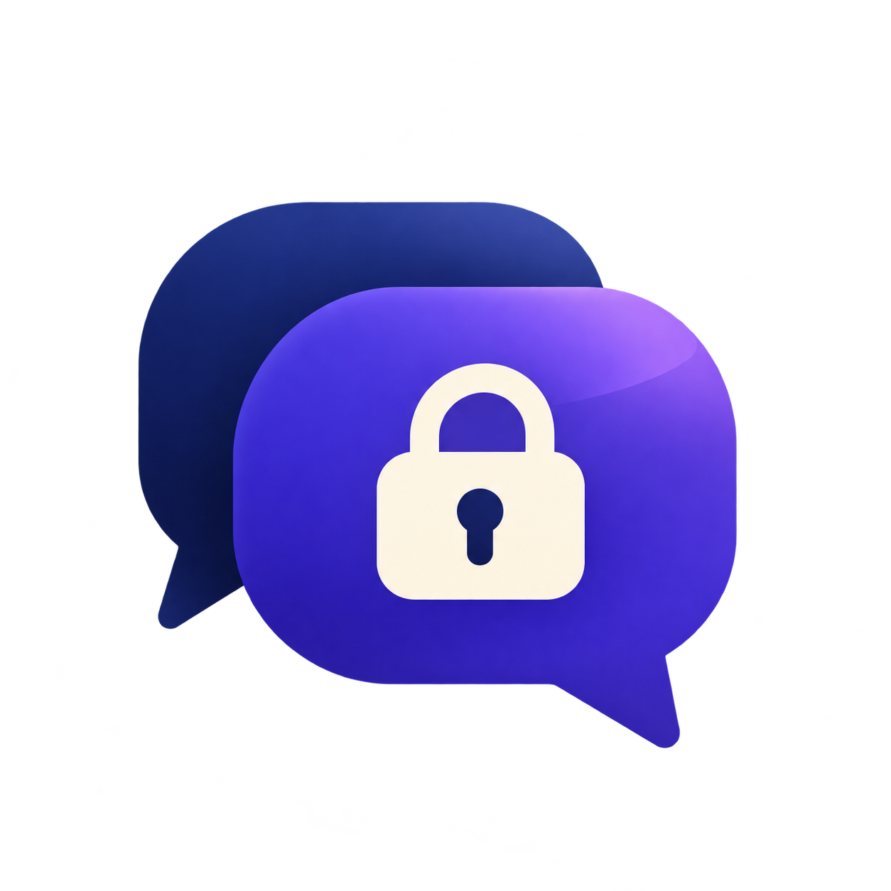

## 🖥️ TTalk pour Windows — version stable 0.5.1

Messagerie texte chiffrée de bout en bout pour **Windows 10 et 11, x64**.

### ⬇️ Télécharger pour Windows

**[Télécharger TTalk Windows x64 (.zip)](https://github.com/btalal/TTalk/releases/download/v0.5.1-windows/ttalk-windows-x64.zip)**

Vous cherchez la version téléphone ? **[Accéder à la version Android](https://github.com/btalal/TTalk/releases/tag/android-v0.5.1)**.

### Installation

1. Téléchargez puis **extrayez entièrement** l’archive ZIP.
2. Ouvrez le dossier extrait et lancez **`TTalk.exe`**.
3. Gardez le dossier `app` à côté du lanceur : il contient les composants nécessaires.
4. Déverrouillez votre coffre avec votre code PIN et utilisez le même relais HTTPS que vos contacts.

### Nouveautés de la version 0.5.1

- **Menus ⋮** pour supprimer messages, conversations et contacts, avec confirmation.
- **Groupes** : effacer l’historique ou quitter et supprimer le groupe de cet appareil.
- **Onglet Contacts** pour retrouver un contact après suppression de la conversation.
- **Personnalisation locale** des noms de contacts/groupes et choix parmi vingt icônes.
- **Correctifs** : code d’appairage renouvelé visible, saisie des codes vérifiée,
  protection contre les doubles envois et la perte d’un brouillon, erreurs de
  sauvegarde signalées et nom actualisé hors ligne.
- **Fiabilité** : choix conservés dans le coffre chiffré ; protection contre la
  réapparition d’un message supprimé lors d’une retransmission.

Les noms et icônes restent propres à cet appareil. Les suppressions locales ne
retirent pas les copies des autres participants ni les fichiers déjà enregistrés.
Un envoi déjà transmis au relais peut encore être livré.

[Guide des nouveaux menus](https://github.com/btalal/TTalk/blob/main/ttalk/docs/CHAT_MANAGEMENT.md)

### Fonctions conservées

- Messages et fichiers entre Windows et Android.
- Contacts et historique conservés après redémarrage.
- Réception des messages en attente à la reconnexion.
- Groupes et transfert de propriété.

Le périmètre précédent a été validé sur deux PC Windows x64 et un smartphone Android.
Les nouveaux menus disposent de tests automatisés ; ces essais ne remplacent pas une qualification sur tous les appareils.

### À savoir

Un relais hébergé reste nécessaire pour relier les appareils. Sur téléphone, les notifications lorsque l’application est fermée sont reportées ; la réception reprend à l’ouverture. La version iPhone reste en préversion.

Autres fichiers et documentation

- `ttalk-windows-x64.zip.sha256` : empreinte permettant de vérifier l’intégrité du ZIP.
- Les liens **Source code** générés par GitHub contiennent les sources, pas l’application à lancer.
- [Guide du relais](https://github.com/btalal/TTalk/blob/main/ttalk/server/README.md) · [Historique des changements](https://github.com/btalal/TTalk/blob/main/ttalk/CHANGELOG.md)

